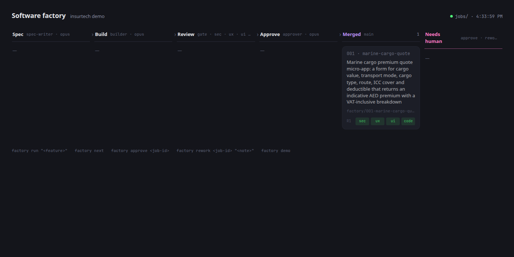
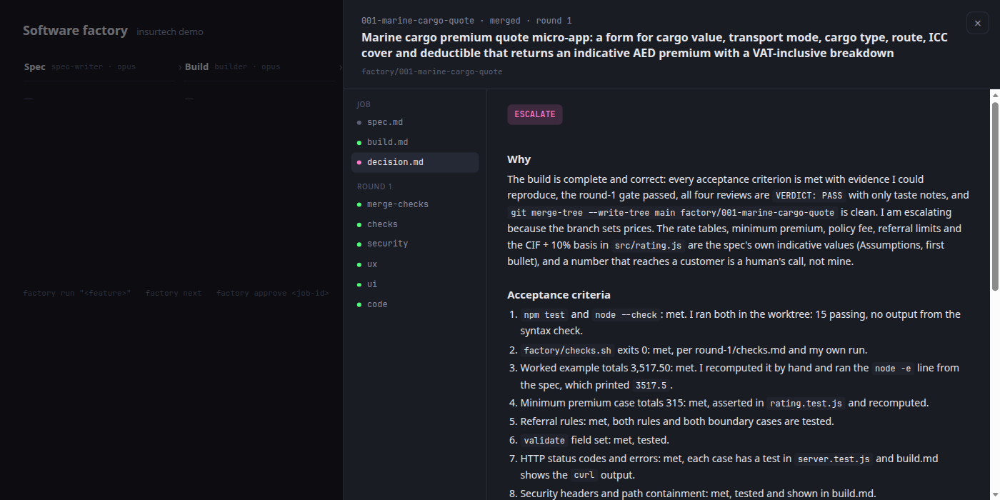
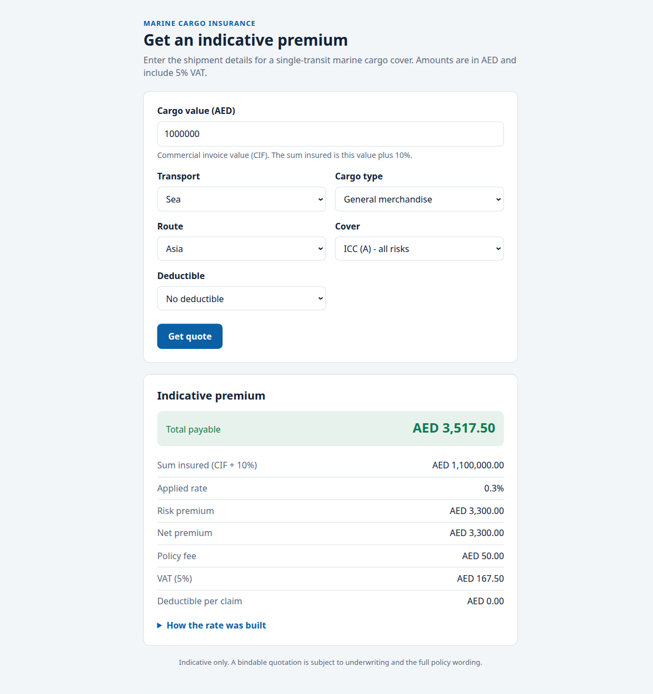
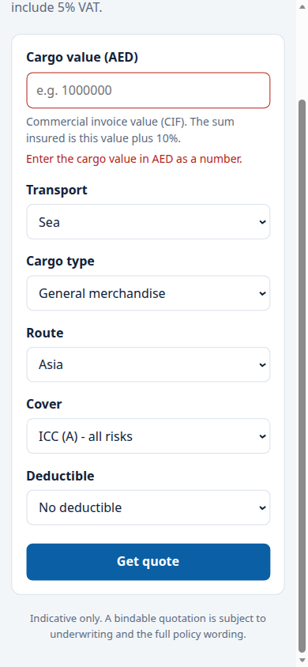

# AI Software Factory, insurtech demo

A runnable demo of the software factory from
[Build Your Own AI Software Factory with Claude Code](../../src/software-factory-claude-code),
set up for a UAE insurtech that ships small marine cargo, liability and claims
apps. You give it a one-line feature request; seven Claude Code agents write a
spec, build the feature on its own branch, run the tests, review it from four
angles, and either merge it or hand it to you with a precise question.

The folder is laid out like a repo root, so it can be copied into a real repo
as-is. It ships with one completed run, job `001-marine-cargo-quote`, whose
output is committed: the spec, the build log, the gate result, four reviews,
the approver's decision, and the working app it produced, with 15 passing
tests.

```
feature → spec-writer → builder → gate (checks.sh) → [security, ux, ui, code] → WAIT FOR ALL
                           ▲             │ FAIL                                      │
                           └─────────────┴──── any CHANGES: resume builder ◄─────────┤
                                                                                     ▼ all PASS
                                                        merge to main ◄─ APPROVE ─ approver ─ ESCALATE → needs-human
```

| | |
|---|---|
|  |  |
|  |  |

## Quick start

Prerequisites for the demo: `git`, `python3` (3.10+), `node` (20+). No API key.

```bash
cd demo/software-factory
make demo
```

That seeds a throwaway repo in `/tmp/software-factory-demo` with the factory
but no apps, then runs job 001 through every stage with a **mock Claude
engine** (see [Mock mode](#mock-mode)) while the real runner does the real
work: creates the worktree and branch, commits the app, runs its tests as the
gate, collects the four verdicts, lets the approver escalate the pricing
decision to you, approves on your behalf, merges into `main`, and runs the
tests once more from `main`. It takes a few seconds and prints every
transition. The last lines tell you where the job's files and the app are.

Then look at it:

```bash
make dashboard                       # http://localhost:8000/dashboard.html, the committed run
make test                            # the gate: every app's tests
cd apps/marine-cargo-quote && npm start   # the sample app at http://localhost:5101
```

To watch the dashboard move while the demo runs, start it from the sandbox in
a second terminal (`python3 /tmp/software-factory-demo/factory/bin/factory
dashboard`) and re-run `make demo`.

## What is in the folder

```
AGENTS.md                      the repo's instructions: layout, app conventions, money rules, commands.
                               Every agent reads this; nothing repo-specific lives in .claude/
.claude/
  skills/factory/SKILL.md      the orchestrator for interactive use: /factory <feature> in a Claude Code session
  agents/                      one file per agent in the loop
    spec-writer.md             opus    writes spec.md
    builder.md                 opus    commits on factory/<job-id>, writes build.md
    reviewer-security.md       opus    writes round-N/review-security.md
    reviewer-ux.md             sonnet  writes round-N/review-ux.md
    reviewer-ui.md             sonnet  writes round-N/review-ui.md
    reviewer-code.md           sonnet  writes round-N/review-code.md
    approver.md                opus    writes decision.md
factory/
  bin/factory                  the headless orchestrator: same loop as SKILL.md, one command
  checks.sh                    the gate: tests of every app under apps/
  backlog.md                   queue for `factory next`
  dashboard.html               the visual board (polls factory/jobs/)
  mock/claude                  scripted stand-in for the claude binary, used by `factory demo`
  jobs/001-marine-cargo-quote/ the committed sample run (new jobs are gitignored)
apps/marine-cargo-quote/       the app job 001 produced: rating engine, HTTP server, form, tests, Dockerfile
docs/                          screenshots
.env.example                   the environment variables the runner reads
Makefile                       demo, test, dashboard, run, next, plan, clean
```

## How each stage works

The design is the original's: agents get their context from files, not the
conversation; each agent writes exactly one file; the first line of that file
is a machine-readable verdict; the orchestrator is the only writer of
`job.json`; every job runs in its own git worktree so several can run at once.
Two things are added from the v2 factory: a scripted test gate between build
and review, and a headless runner so the loop can be started with one command
or from CI.

1. **Create.** `factory run "<feature>"` claims the next job number
   (`mkdir` without `-p`, so two sessions can't take the same one), writes
   `factory/jobs/<job-id>/job.json`, and creates `../<repo>-factory/<job-id>`
   as a worktree on branch `factory/<job-id>` from `main`.
2. **Spec** (`spec-writer`, Opus). Reads `AGENTS.md` and the code the feature
   touches, writes `spec.md`: context with real paths, numbered requirements,
   numbered acceptance criteria that anyone with the repo can check, what is
   out of scope, and the assumptions it made. For insurance work it must state
   inputs, formula, rounding, currency and VAT treatment with one worked
   example in AED, and list every rate, fee and piece of customer wording it
   chose under Assumptions so the approver can escalate them.
3. **Build** (`builder`, Opus). Works only in the worktree, implements the
   spec, verifies every acceptance criterion and records the evidence, commits
   with short messages, and writes `build.md` starting `STATUS: READY` or
   `STATUS: BLOCKED`. The same builder session is resumed for later rounds
   (`--resume` in headless mode, `SendMessage` in a Claude Code session).
4. **Gate** (script). The runner executes the main checkout's
   `factory/checks.sh` inside the worktree and writes `round-N/checks.md`
   (`GATE: PASS|FAIL`, the commit, the output). A failing gate goes straight
   back to the builder with the log; no reviewer is spawned for code that
   doesn't pass its own tests. Because it is the main checkout's copy, a
   branch can't change the checks it is judged by.
5. **Review** (four reviewers in parallel). Security (Opus), UX, UI and code
   (Sonnet) each read the spec, the build log and the diff, and write
   `round-N/review-<lens>.md` starting `VERDICT: PASS` or `VERDICT: CHANGES`.
   The checklists are tuned for this repo: customer data never logged,
   integer-fils money, VAT as its own line, indicative-only wording, referral
   instead of silent fallback, path containment and CSP for the static server.
   **WAIT FOR ALL**: the round is done only when all four files exist. Any
   CHANGES resumes the builder, at most `FACTORY_MAX_RESUMES` (2) times, so a
   run has at most three rounds.
6. **Approve** (`approver`, Opus). Re-checks the acceptance criteria itself,
   recomputes the worked example, checks the merge is clean, and writes
   `decision.md` starting `APPROVE` or `ESCALATE`. It escalates anything that
   sets a price, adds customer-facing wording about cover, stores or sends
   customer data, touches auth, deploy or CI, or adds a dependency. Most first
   versions of an insurance app escalate on the pricing rule; that is the
   design, not a failure.
7. **Merge or hand over.** `APPROVE` merges `factory/<job-id>` into `main`
   with `--no-ff` in the main checkout (which must be clean and on `main`),
   after running the gate once more. `ESCALATE` leaves the branch and worktree
   in place and prints the decision. You then run
   `factory approve <job-id>` to merge, or `factory rework <job-id> "<note>"`
   to send your note to the builder for another round. The factory never
   pushes and never deploys.

Every transition is written to `job.json`, and the dashboard polls
`factory/jobs/` every two seconds, so cards move across the columns and review
chips fill in as verdicts land. Click a card to read its files.

### The sample run

`factory/jobs/001-marine-cargo-quote/` is the trace of one job:

- `spec.md`: a marine cargo quote app with a rating formula (sum insured =
  CIF + 10%; rate = base by transport × cargo type × route × ICC cover ×
  deductible; minimum premium AED 250; policy fee AED 50; 5% VAT), two
  referral rules, the HTTP contract, the form, and eleven acceptance criteria.
- `build.md`: `STATUS: READY`, with evidence per criterion.
- `round-1/checks.md`: `GATE: PASS`, 15 tests.
- `round-1/review-{security,ux,ui,code}.md`: four `VERDICT: PASS`, notes only.
- `decision.md`: `ESCALATE`, because the branch sets prices. It lists the
  exact numbers a human must sign off on.
- `round-1/merge-checks.md`: the gate run again just before the merge, after
  `factory approve`.
- `job.json`: `stage: merged`.

The app it produced is `apps/marine-cargo-quote/`: `src/rating.js` (pure,
integer fils), `src/server.js` (`node:http`, 16 KiB body limit, CSP, no request
logging), a one-page form, and `test/` with 15 `node:test` cases. Worked
example: AED 1,000,000 of general cargo by sea to Asia under ICC (A) with no
deductible comes to **AED 3,517.50** (3,300.00 net + 50.00 fee + 167.50 VAT).

## Mock mode

Claude Code could not run in the environment this demo was built in (no
Anthropic credentials), so the pipeline ships with a mock engine and the demo
runs on it. Be clear about what that means:

- `factory/mock/claude` is a script the runner spawns **with the exact
  arguments it would pass to the real `claude` binary**
  (`-p <prompt> --agent <name> --output-format json …`). Instead of calling a
  model, each agent copies the file it would have written from the committed
  sample run, and the builder also copies the app's code into the worktree,
  runs its tests and commits. It prints the same JSON result envelope Claude
  Code prints.
- Everything else in the demo is real: the worktree and branch, the commit,
  `checks.sh` running the tests, verdict parsing, the needs-human stop, the
  approval, the merge, and the tests running again from `main`.
- The agent files in the sample job were written to the agents' file contracts
  by the author of this demo, not by a live Claude Code session. The app's
  tests, the `curl` checks and the browser checks they cite were actually run.
- The mock knows only the sample job. Ask it for anything else and it returns
  an error result, exactly as a failed agent would, and the job goes to
  `needs-human`.

Run with real Claude Code:

```bash
npm install -g @anthropic-ai/claude-code
claude login                              # or put ANTHROPIC_API_KEY in .env
cp .env.example .env                      # optional; the defaults work
make plan FEATURE="FNOL form for marine cargo claims"   # prints the claude commands, runs nothing
make run  FEATURE="FNOL form for marine cargo claims"   # runs the job
make next                                                # or take the first unchecked backlog item
```

Each agent runs as `claude -p --agent <name>` with the agent's own model and
tool list from `.claude/agents/<name>.md`, `--permission-mode acceptEdits`,
`--permission-prompts none` (nothing can hang on a prompt; anything not
pre-allowed is denied and the agent is told), `--allowedTools` set to the
agent's tools, and `--add-dir <worktree>`. The builder's tools include `Bash`,
so it can run `git` and `npm` in the worktree; run the factory in a container
or VM you'd be happy to let an agent use a shell in. `FACTORY_CLAUDE_FLAGS`
adds flags to every call; `--max-budget-usd 5` is a sensible cap per agent
run. You can also skip the runner and type `/factory <feature>` in a Claude
Code session opened in this folder; the skill orchestrates the same loop with
subagents.

## Commands

```
make demo                          replay the sample job in a throwaway repo (mock engine)
make test                          bash factory/checks.sh
make dashboard                     serve factory/ and open http://localhost:8000/dashboard.html
make run  FEATURE="..."            factory run "<feature>"        (real Claude Code)
make next                          factory next                   (first unchecked backlog item)
make plan FEATURE="..."            factory plan "<feature>"       (print the commands, run nothing)
make clean                         remove the demo sandbox

python3 factory/bin/factory approve <job-id>          merge a needs-human job
python3 factory/bin/factory rework  <job-id> "<note>" send it back to the builder with your note
python3 factory/bin/factory status                    one line per job
python3 factory/bin/factory demo --sandbox <dir>      put the sandbox somewhere else
```

Configuration is by environment variable, with `.env` as an optional source
(`.env.example` lists them). No secret is read from anywhere else, and `.env`
is gitignored.

## Using it on a real repo

1. Copy `.claude/`, `factory/`, `AGENTS.md` and `.env.example` into the repo
   root (or a subfolder; the runner handles both). Delete `factory/jobs/001-*`
   and the checked backlog items, and drop `apps/` if you don't want the
   sample app.
2. Rewrite `AGENTS.md` for your repo: layout, how to install and start the
   app, the validation commands, the conventions, and the money and data
   rules. Agents carry nothing repo-specific.
3. Put your real test, lint, type-check and build commands in
   `factory/checks.sh`. The gate and the builder both run it.
4. Ask Claude to tailor the review checklists and the approver's escalation
   list to your stack and your regulator's expectations.
5. Install [`agent-browser`](https://github.com/vercel-labs/agent-browser) if
   your apps have pages; the builder and the UX and UI reviewers use it when
   it is present and fall back to reading the HTML and `curl` when it isn't.
6. Commit on `main`, then `make run FEATURE="…"`.

## Plugging in later

The factory ends at a local merge on purpose. These are the two integrations
the loop is shaped for, neither of which is wired up in this demo.

### GitHub pull requests

The v2 factory in this repo
([`software-factory-claude-code-v2`](../../src/software-factory-claude-code-v2))
does this; the same shape fits here:

- **Queue.** Replace `factory/backlog.md` with GitHub issues labeled
  `factory`; `factory next` becomes `gh issue list --label factory` and the
  issue body is quoted into the job folder as data, never as a prompt.
- **Build.** After round 1 the builder pushes `factory/<job-id>` and opens a
  draft PR with `gh pr create --draft --body "Closes #<n>"`. Later rounds push
  to the same branch.
- **Gate in CI.** Put `bash factory/checks.sh` in a workflow that runs on
  `factory/**` branches. The runner's gate still runs locally for speed; the
  approver reads the PR's check status too.
- **Reviews as PR comments.** Each `review-*.md` is posted with
  `gh pr comment`, so the conversation lives on the PR.
- **Approve.** `APPROVE` becomes `gh pr ready` and `gh pr merge --merge`, so
  branch protection and required checks apply and the main checkout is never
  touched. `ESCALATE` becomes `gh pr ready` plus the decision as a comment and
  a `factory:needs-human` label; merging the PR on GitHub is the approval.

### Google Cloud Run preview revisions with no traffic

`apps/marine-cargo-quote/Dockerfile` already builds a Cloud Run-compatible
image (listens on `$PORT`, runs as a non-root user). A preview step would sit
between the gate and the reviewers:

```bash
# in the job's worktree, from the app folder
gcloud run deploy marine-cargo-quote \
  --source . \
  --region me-central1 \
  --no-traffic \
  --tag job-001 \
  --platform managed
```

- `--no-traffic` deploys a new revision that receives none of the production
  traffic; `--tag job-001` gives it its own URL,
  `https://job-001---marine-cargo-quote-<hash>.a.run.app`.
- The runner writes that URL into `job.json` and passes it to `reviewer-ux`
  and `reviewer-ui` in place of a local port, and posts it on the PR so a
  human can click through before approving.
- On merge: `gcloud run services update-traffic marine-cargo-quote
  --to-latest` promotes it, or a normal production deploy from `main` does.
  On rejection or after merge: `gcloud run services update-traffic
  marine-cargo-quote --remove-tags job-001` and
  `gcloud run revisions delete <revision>` clean up.
- `me-central1` (Doha) is the closest region to the UAE today; data residency
  is a decision for Tamer, not the factory. The approver's escalation list
  already covers "changes deploy, CI or hosting config", so wiring this in is
  itself a job a human signs off on.

## Limits

- No Claude Code run happened in this demo's build environment. Real mode is
  exercised only as far as command construction, spawning and error handling
  (a `claude` that isn't logged in makes the job stop cleanly in
  `needs-human`). The agent prompts follow the original factory's, with
  insurance-specific checklists, but have not been run against a model here.
- The rating tables are indicative demo values; the approver escalates them
  for that reason.
- The merge step needs the main checkout clean and on `main`, as in the
  original. The GitHub PR integration above removes that constraint.
- `factory/jobs/` is gitignored except for the sample job, so a job's trace
  stays on the machine that ran it until you commit it on purpose.
